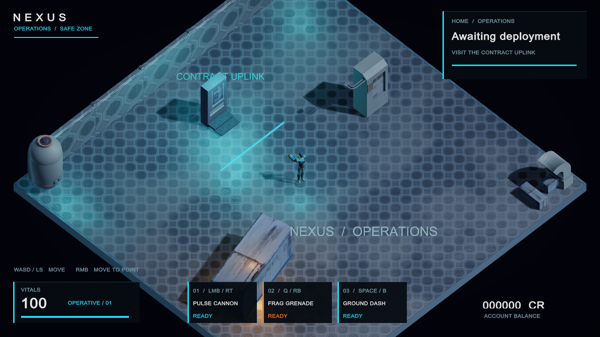
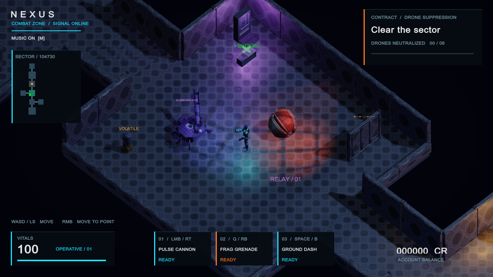
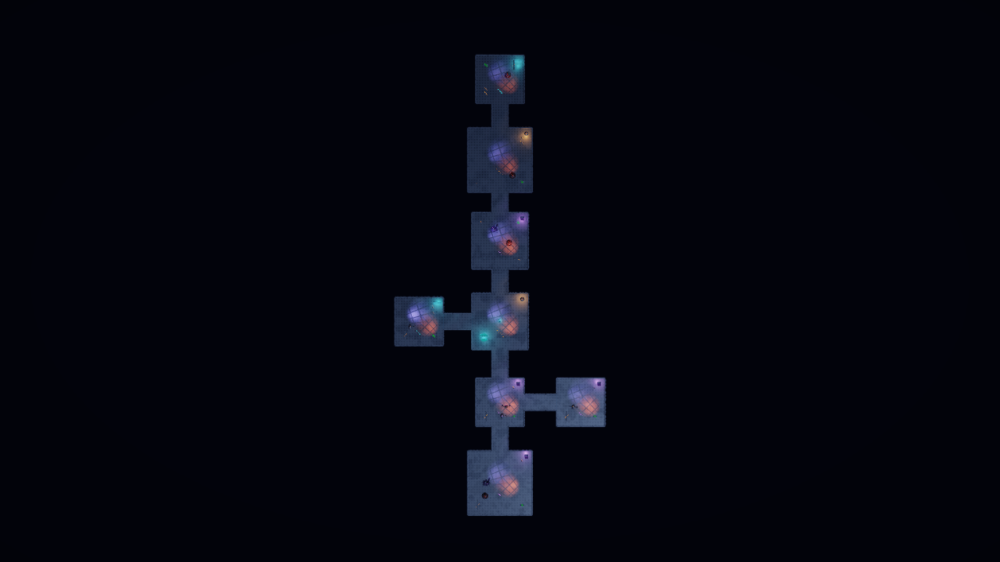
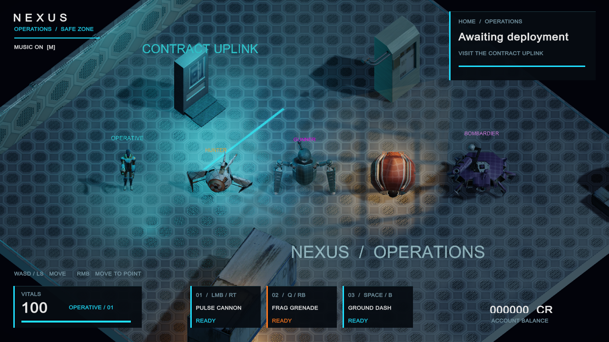
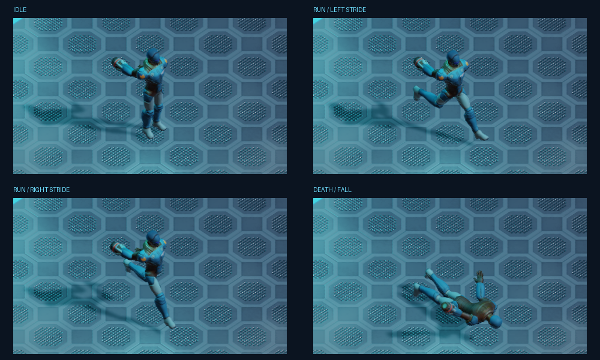

# Sci-fi action RPG prototype

Unity **6000.3.26f1**, C#, PC. Early local single-player proof of concept.

Open this directory in Unity Hub using the pinned Editor. Allow package import and scene setup to complete, open `Assets/Game/Scenes/Prototype.unity`, then press Play. The editor setup creates that scene on first import if needed.

Use WASD or right-click to move; mouse to aim; left-click to shoot; Q for a grenade; Space to dash; E to interact. Controller: left stick moves, right stick aims, RT fires, RB throws a grenade, B dashes, A interacts.

Approach the cyan contract terminal, accept a mission, kill eight drones in the procedural area, return to the green extraction beacon, then claim the reward at the hub terminal.

Each contract generates eight connected rooms with varied sizes, industrial themes, branching passages and safe doorway approaches. The sector map shows your position and extraction; its displayed seed identifies the layout. Enemies route through room doorways, and reinforcements keep the field active after the objective completes.

Encounters include hunters, gunners, fast melee rushers, and bombardiers with marked AOE blasts. Shoot green medical caches and walk over the dropped medkit to heal. Enemy fire can detonate barrels or topple unstable cover onto you. Lethal damage plays a death animation before emergency recall to the Nexus.

The player and all four enemy roles use different models. Nexus and combat zones have separate music, crossfades, atmospheric overhead lighting, light shafts, haze, and dust. Press M or click MUSIC to mute/unmute the soundtrack.

- [Game profile](docs/GAME_PROFILE.md)
- [Development pipeline and testing](docs/DEVELOPMENT.md)
- [Validation and current limitations](docs/VALIDATION.md)
- [Asset sources and licenses](docs/ASSETS.md)
- [Health bars, reinforcements and destructibles](docs/COMBAT_WORLD.md)

License-free core checks: `dotnet run --project Tests/CoreChecks/CoreChecks.csproj --configuration Release`.

Full local tests: `./scripts/Test-Local.ps1 -UnityPath '<full path to Unity.exe>'`.

Build a Windows player with Unity's `-batchmode -quit -projectPath <project> -executeMethod VideoGame.Editor.ProjectSetup.BuildWindows` arguments. Output: `Builds/Windows/VideoGame.exe`. Run the executable from that folder with its data files beside it.
