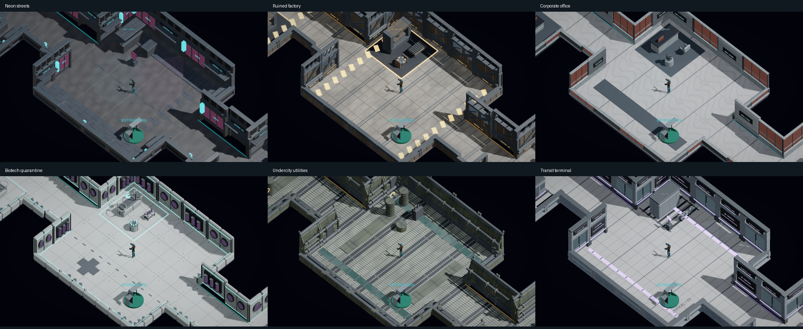

# Procedural biomes - generation recipe v3

Six playable themes: Neon Street District, Ruined Automation Factory, Corporate Office Breach, Biotech Quarantine, Undercity Utilities and Elevated Transit Terminal.

## Deployment

At the Nexus, interact with the cyan terminal (E / controller A or the prompt). The mission list offers all six biomes. Select a destination to launch the existing eight-target contract there. Each terminal mission chooses 6, 10 or 20 rooms from its seed; corridors are additional and never consume room slots. Cancel / Escape / controller B returns to the Nexus without accepting a mission or consuming a seed. The old HUD/pause deployment-settings shortcuts are replaced by this terminal flow. Existing saved biome/size preferences remain compatible with debug/capture helpers; they do not override terminal mission choices or random sizes. Claim any completed mission reward at the terminal before taking the next contract.

A recipe records seed, generator version 3, resolved biome and exact room count. Topology is the existing connected frontier room graph with 12/14/16-metre rooms, 20-metre centre spacing and four-metre passages. Room/corridor floor bounds and opposing door openings share these measurements. Door lanes, spawn and extraction are protected. Random choices use independent recipe, layout and per-room dressing streams; dressing does not consume layout RNG. Same seed/configuration reproduces topology and decoration. Combat-state persistence remains Nexus-only.

## Visual kits

Original Blender-authored modules: eleven roles per theme, 66 FBX files, 94,332 source triangles across the complete library. Roles are two wall compositions, floor tile, room surface, feature, landmark, service, detail, animated object, volatile container and unstable partition. Each biome has original 512-pixel floor and wall color/normal maps. Shell/trim/glow/dark/glass materials are shared within each biome. Four-metre wall/floor sockets preserve the imported FBX axis transform. Walls have different structural geometry, rather than a shared wall box with changed accents. Back-wall height varies from three-metre office/lab partitions through tunnel shoulders to 4.2-metre storefronts, factory trusses and station beams. Front walls retain the existing camera cutaway policy, with matching collision. Deep corridor modules are offset by their measured inward extent so four metres means usable passage width, including with storefront overhangs and pipes.

| Biome | Architecture and landmarks | Furniture / animated object |
| --- | --- | --- |
| Neon streets | masonry storefronts, shutter/awning or window/blade sign, asphalt/grates, street-food stall | dumpster, litter/bollard, rotating advertisement |
| Ruined factory | steel I-beams, diagonal braces, pressure mains or damaged glazing, rail/hazard floors, hydraulic press | roller conveyor, scrap pipes, motor flywheel |
| Corporate offices | slim glazing with privacy bands or slatted company wall, stone floors, reception island | upholstered chair, planter, kinetic sculpture |
| Biotech quarantine | thick sealed panels, circular observation ports or wall specimens, gasket floors, isolation bed/scanner | sample trolley, contamination clusters, centrifuge |
| Undercity utilities | tunnel shoulders, flanged pipework or maintenance hatch, drain/grate floors, twin filter tanks | electrical junction, tools/cable, extractor impeller |
| Transit terminal | station columns, screen doors or route-map wall, tactile floor strips, parked metro section | station bench, luggage, rotating line signal |

Room surfaces add broad pavements/crossings, assembly work cells, carpet islands, clinical bay outlines, water channels or platform/track markings instead of repeating these on every tile. These shallow overlays have no colliders; the existing floor remains authoritative. Seeded corner compositions alternate landmarks and feature props; larger rooms also receive service/detail furniture. Small rooms use compact feature props and omit side furniture to preserve clearance. The arrival room keeps its dressing opposite the extraction corner. Quarter-turn and small scale/offset variation stay independent of topology RNG. Biome-specific explosive containers and unstable partitions retain the existing damage, collapse, collision and interaction rules. Green medical caches keep their recognizable appearance. The four-metre central cross, door approaches, spawn and extraction remain protected. Nearby motion activates within 30 metres and freezes with gameplay pause; it never moves collision hulls.

Room counts, topology, music, lighting and enemy weights retain the previous deployment behavior. This pass changes the architectural assets and dressing; it does not introduce new navigation or enemy systems. The shared connected-room graph remains a limitation: streets and office floors still use the same graph rules, despite their distinct kits.

## Music and roster

Six original 16-bar stereo ambient compositions are generated offline by Tools/Art/generate_biome_media.py, with different tempos, roots, harmonic patterns and instrumentation/arrangement. No external samples or paid services are used. Audio imports stream Vorbis-compressed data. Nexus retains its existing licensed theme. A fixed set of seven sources crossfades between Nexus and the selected biome; all music respects master/music volume, music mute and existing pause/death behavior. Scene resets stop old-world effects; music sources remain owned by the game instance rather than accumulating per room or mission.

Existing enemy models and behavior are retained. Biomes bias the existing Hunter/Gunner/Rusher/Bombardier roster differently for initial spawns and reinforcements. Initial population and reinforcements both respect the 12-enemy cap, including large maps. The approved new biome-specific enemy art and shielded heavy remain a separate asset/gameplay task.

## Sources, reproduction and evidence

- Mesh source: Tools/Art/export_biomes.py; run with the pinned Blender 4.5.9 background executable. Models/manifest.json records triangle counts, metre bounds and moving-node identity.
- Surface source: Tools/Art/generate_biome_surfaces.py; run after the media generator to author the current wall/floor maps.
- Media source: Tools/Art/generate_biome_media.py; requires numpy and Pillow. media-manifest.json records duration, tempo, peak and RMS for every original loop. Texture and audio outputs are committed.
- Unity import/material assembly: BiomeAssets.Build, also called by the Windows build. Shared meshes, materials and streaming clips are reused.
- POC_CAPTURE_BIOMES enables an isolated staged visual capture of each theme and a 20-room overview. It bypasses normal profile loading/saving, disables enemy AI, captures a second comparison under white lighting with fog off, and labels evidence as staged rather than natural mission completion.
- Core checks exercise all biome/size pairs across 100 seeds plus random-choice coverage/determinism. Runtime tests exercise all 18 biome/size combinations, three-lane corridor/floor clearance, furniture/hazard overlap, module dimensions, spawn cap, dressing replay, motion pause/cleanup and distinct music/mute behavior. Menu coverage checks all six destination launches, random-size override of legacy preferences, range/cancel guards, and keyboard/mouse/controller input handoff.

Subjective music preference, physical-controller feel and full target-hardware frame-time profiling remain human playtest items. Environment kits are intentionally expandable; additional authored prop variants can be added through the same shared sockets and protected placement zones.

Architectural overhaul validation: 17,420 core assertions, four EditMode tests and 51 PlayMode tests passed. Final complete local suite: 97.7 seconds. Final Windows build: 11.0 seconds after a surface-art alignment correction. The eight-second player smoke passed; final captures show all six kits in biome and neutral lighting. Physical-controller and subjective art/audio acceptance remain human playtest items.
