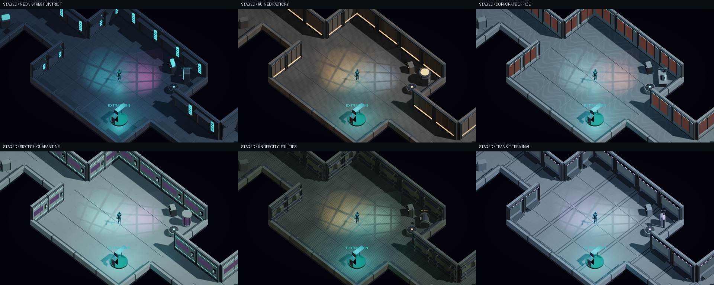
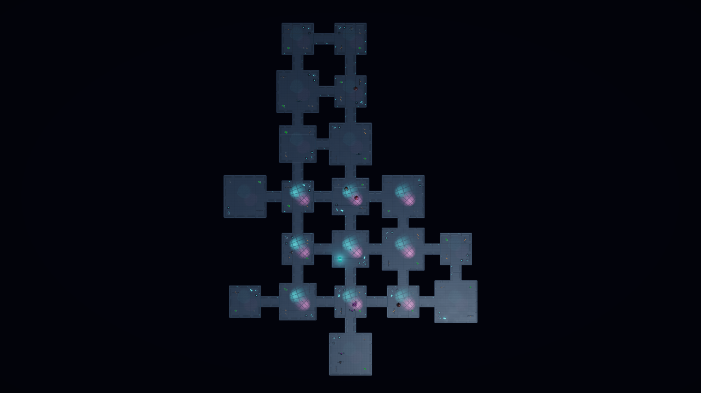

# Procedural biomes - generation recipe v2

Six playable themes: Neon Street District, Ruined Automation Factory, Corporate Office Breach, Biotech Quarantine, Undercity Utilities and Elevated Transit Terminal.

## Deployment

At the Nexus, use NEXT DEPLOYMENT / BIOME & SIZE, or Pause -> Next Deployment. Choose a fixed biome or Random, and Small (6 rooms), Medium (10), Large (20), or Random. Corridors are additional and never consume room slots. Preferences persist separately from Nexus checkpoints; changing them affects the next accepted contract. Defaults randomize both from the mission seed.

A recipe records seed, generator version 2, resolved biome and exact room count. Topology is the existing connected frontier room graph with 12/14/16-metre rooms, 20-metre centre spacing and four-metre passages. Room/corridor floor bounds and opposing door openings share these measurements. Door lanes, spawn and extraction are protected. Random choices use independent recipe, layout and per-room dressing streams; dressing does not consume layout RNG. Same seed/configuration reproduces topology and decoration. Combat-state persistence remains Nexus-only.

## Visual kits

Original Blender-authored modules: five roles per theme (wall, floor, feature prop, service prop and moving vent), 30 FBX files total. Shell/trim/glow/dark/glass material slots share biome materials. Each floor uses an original 512-pixel color/normal tile. Four-metre wall/floor modules retain the FBX importer unit/axis transform under a placement root. Placement scales only the declared module axes to fit room wings and corridor lengths. Static solids use measured render bounds as conservative box hulls. Front-facing walls are deliberately low for the isometric camera; collision scales with the visible wall.

| Biome | Architecture / feature | Motion / atmosphere | Music direction |
| --- | --- | --- | --- |
| Neon streets | shop shutters, advertising, vending machine | rotating ventilation, rain, cyan/magenta practical light | gritty bass, syncopated electronic pulse |
| Ruined factory | riveted panels, conduits, furnace vessel | rotor machinery, drifting steam, amber/cold light | slower industrial bass and metallic percussion |
| Corporate offices | glazing, stone skirting, workstation | ventilation, cool architectural light and emergency red | restrained precise arpeggios |
| Biotech quarantine | clean seals, observation glass, specimen pod | scanning/vent rotors, drifting dust, cyan/violet light | sparse uneasy pads and bell motifs |
| Undercity utilities | layered pipework, pressure pump, service cabinets | ventilation, steam, orange/green utility light | low bass, sparse mechanical accents |
| Transit terminal | station glazing, seating, ticket kiosk and route pylon | ventilation, cold dawn fill and violet light | brighter propulsive arpeggios |

The room dressing varies quarter-turn, orientation, small prop scale/offset, optional service/vent choice and count. Destructible barrels/walls/medical caches occupy separately reserved corners. Animated rotors are presentation-only; solid hulls do not move. Nearby room lights and rotor motion activate within 30 metres; motion freezes with gameplay pause. Rain/steam/dust use bounded particle systems. These are the first modular interpretations of the approved concepts, not hand-built replicas of every concept detail.

## Music and roster

Six original 16-bar stereo ambient compositions are generated offline by Tools/Art/generate_biome_media.py, with different tempos, roots, harmonic patterns and instrumentation/arrangement. No external samples or paid services are used. Audio imports stream Vorbis-compressed data. Nexus retains its existing licensed theme. A fixed set of seven sources crossfades between Nexus and the selected biome; all music respects master/music volume, music mute and existing pause/death behavior. Scene resets stop old-world effects; music sources remain owned by the game instance rather than accumulating per room or mission.

Existing enemy models and behavior are retained. Biomes bias the existing Hunter/Gunner/Rusher/Bombardier roster differently for initial spawns and reinforcements. Initial population and reinforcements both respect the 12-enemy cap, including large maps. The approved new biome-specific enemy art and shielded heavy remain a separate asset/gameplay task.

## Sources, reproduction and evidence

- Mesh source: Tools/Art/export_biomes.py; run with the pinned Blender 4.5.9 background executable. Models/manifest.json records triangle counts, metre bounds and moving-node identity.
- Media source: Tools/Art/generate_biome_media.py; requires numpy and Pillow. media-manifest.json records duration, tempo, peak and RMS for every original loop. Texture and audio outputs are committed.
- Unity import/material assembly: BiomeAssets.Build, also called by the Windows build. Shared meshes, materials and streaming clips are reused.
- POC_CAPTURE_BIOMES enables an isolated staged visual capture of each theme and a 20-room overview. It bypasses normal profile loading/saving, disables enemy AI, and labels evidence as staged rather than natural mission completion.
- Core checks exercise all biome/size pairs across 100 seeds plus random-choice coverage/determinism. Runtime tests exercise all 18 biome/size combinations, corridor/floor clearance, module dimensions, spawn cap, dressing replay, motion pause/cleanup and distinct music/mute behavior. Menu coverage checks saved deployment selection and the Nexus-only edit boundary.

Subjective music preference, physical-controller feel and full target-hardware frame-time profiling remain human playtest items. Environment kits are intentionally expandable; additional authored prop variants can be added through the same shared sockets and protected placement zones.

Final local validation: 17,420 core assertions; four EditMode and 51 PlayMode tests passed. Complete final local run: 85.5 seconds. Windows build: 19.9 seconds for the initial asset build, followed by a corrected-material build; final eight-second player smoke passed. Visual captures show staged room composition, not a natural mission clear.
