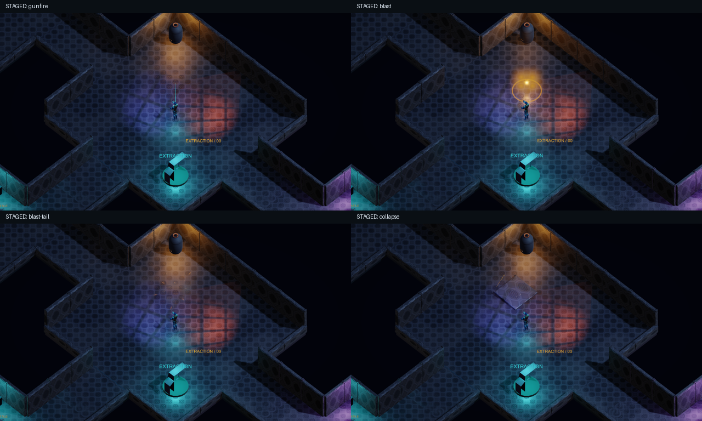

# Combat feedback pass — revision 1

Scope: gunfire, confirmed impacts, explosions and destruction presentation on PC (keyboard/mouse and controller). Damage, cooldowns, collision, enemy decisions and mission rewards are unchanged. No gameplay hitstop or whole-world slowdown is added.

## Event mapping

| Event source | Presentation | Lifetime / retrigger |
| --- | --- | --- |
| Pilot confirmed fire / enemy bolt launch | cyan/orange tracer or muzzle accent, model recoil, gun transient/body/tail | 0.09s visual, 0.16s audio; one request per shot |
| Confirmed gun/bolt contact | metal or robot cue and sparks | 0.55s visual; each actual collision may retrigger |
| Enemy damage | pale hit sparks plus existing Hit animation | 0.55s, capped pool |
| Grenade, barrel or mortar detonation | ground shockwave, short fire plume, warm flash, sparks, alpha-blended smoke, weighted blast sound, distance-scaled shake | ring 0.28s, flash at most 0.12s, smoke at most 1.8s |
| Medical crate break / bulkhead break | green/amber fragments, dust and break sound | at most 1.6s, destruction guard prevents duplicate breaks |
| Bulkhead lands | dust, fragments, heavy collapse sound and shake | at most 1.7s, existing fall routine owns timing and damage |

The punchy VFX and layered-action audio modes are implemented by CombatFeedback. Cues use two deterministic round-robin variants per kind. Noise synthesis uses a separate System.Random; particle systems have fixed independent seeds. Buffers are generated during initialization, never on a hit. These original procedural sounds have no external asset/license dependency; human listening and mix preference remain unverified.

## Limits and lifecycle

24 reusable visual slots, each capped at 40 sparks and 12 smoke particles; 12 audio voices; at most two optional dynamic lights. No per-hit GameObjects, materials or clips are created. Saturation steals older effects/voices of equal or lower priority, otherwise drops optional presentation. Heavy blast/collapse audio has priority over gunfire. Visual fragments are particles, with no colliders or damage. Existing gameplay warning rings remain separate.

Audio respects Master and Effects volume, uses player-relative attenuation/stereo positioning, and pauses with the existing listener policy. Presentation ages and recoil freeze on pause. Hub/mission resets clear all pooled effects, voices and shake; game teardown releases synthesized clips and the shared smoke material.

Options -> Display & Graphics adds Screen Shake (0–100%, default 50%) and Reduced Effects. Reduced Effects removes optional flashes, shockwaves and shake and reduces particle counts. Attack warnings and gameplay outcomes remain unchanged. Camera shake is bounded and rejects offsets that intersect solid scenery. Recoil affects only the rendered model, never the actor collider or aim direction.

## Validation

The staged capture hook POC_CAPTURE_FEEDBACK writes gunfire.png, blast.png, blast-tail.png and collapse.png to the requested directory without enabling profile saving. It disables enemy AI to isolate presentation: these are effect-composition evidence, not natural encounter completion evidence.

Automated regressions check capped overlap, no presentation damage, expiry/reset cleanup, pause, reduced effects, effects mute, finite bounded non-silent synthesis and legacy preference defaults. Existing collision, cover fall, chain reaction, controller and mission tests remain the gameplay evidence. Frame-time profiling on target hardware and subjective sound/combat feel need a human playtest.

Local evidence: the complete suite passed (12,017 core assertions, four EditMode and 47 PlayMode tests) in 84.9 seconds. Later presentation-only tuning was checked with the focused feedback and pause-click tests. Windows build/startup and fixed-timing offscreen captures were checked separately. The capture harness uses 60 logical frames per second and writes no normal profile saves.

